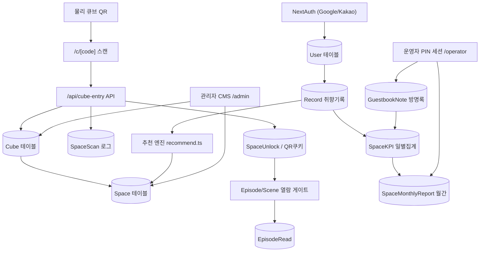
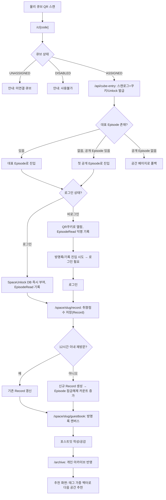
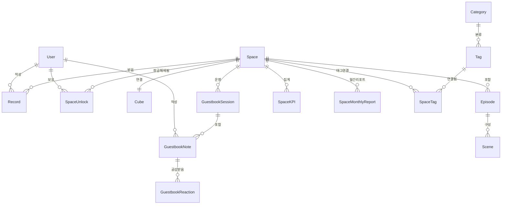
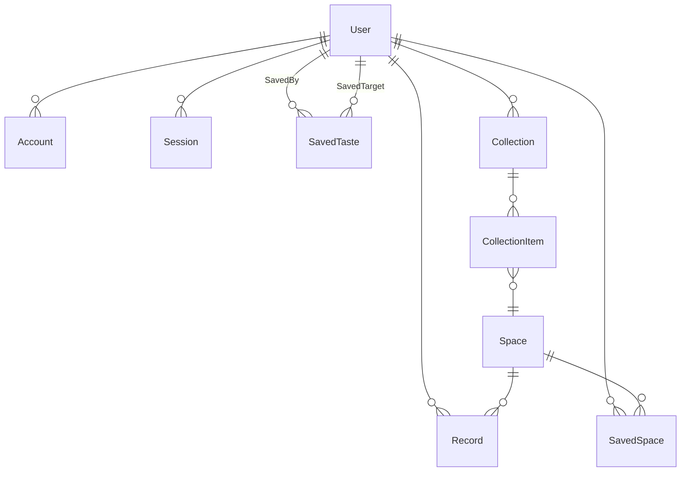
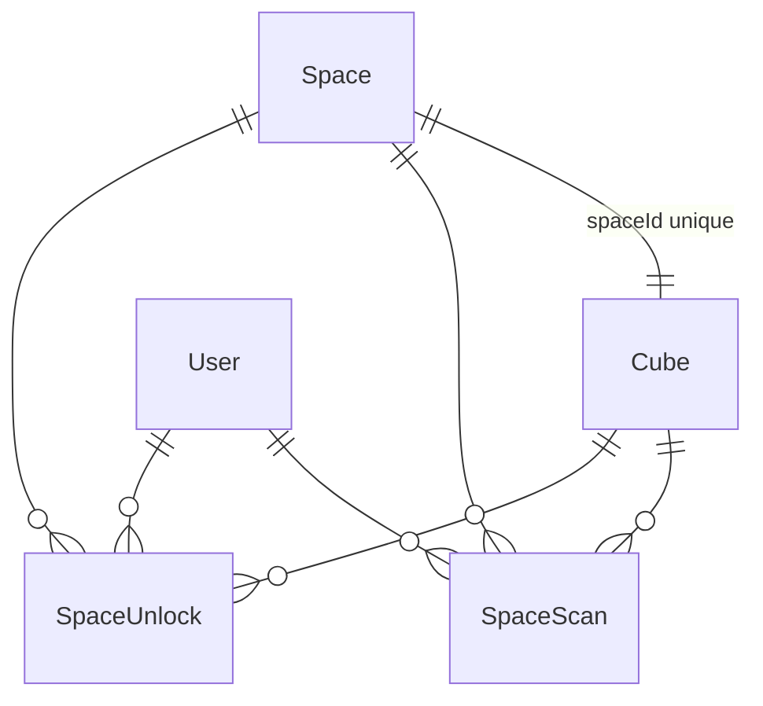
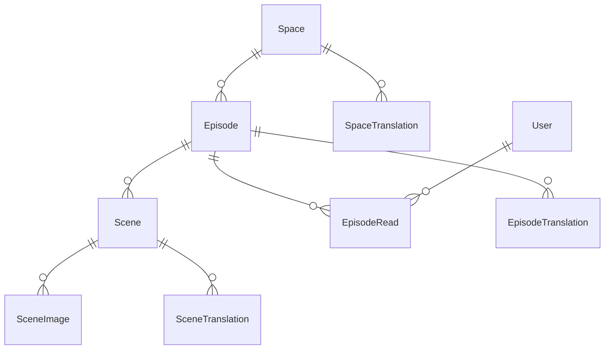
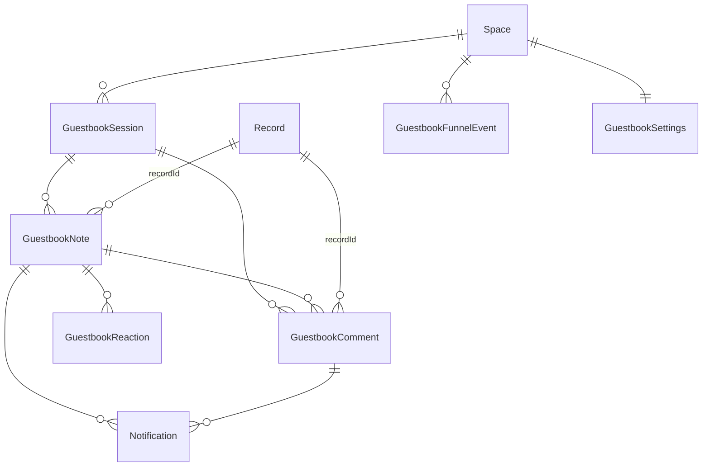
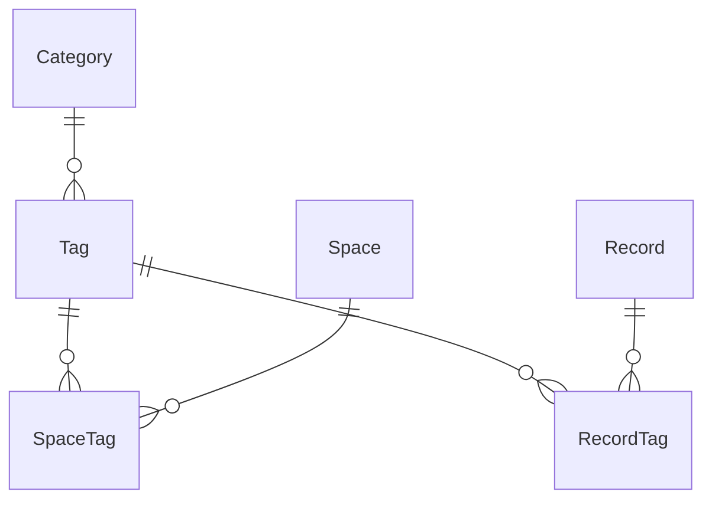
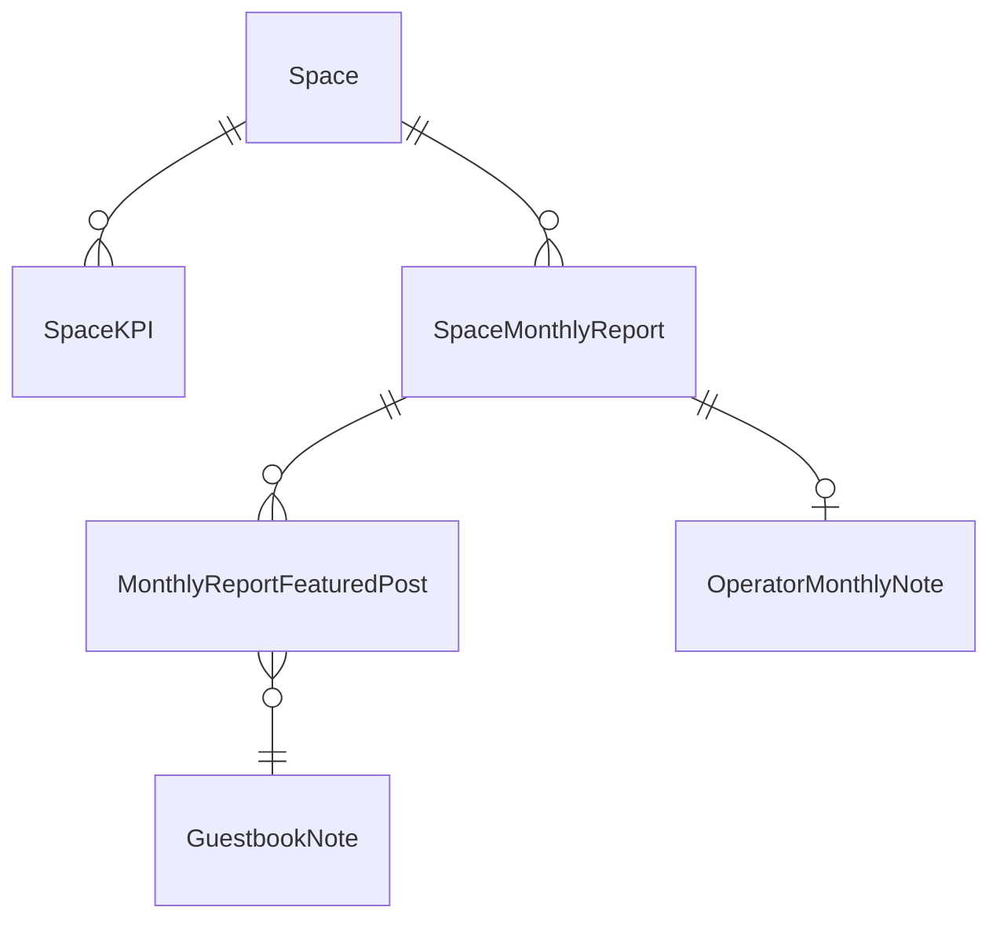
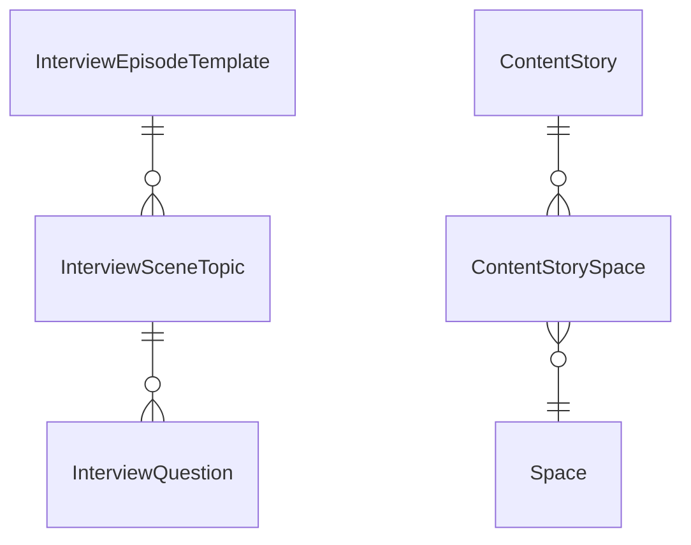

# 공간큐브(SpaceCube) 2026 한이음 드림업 제출자료 — 기술 분석 보고서

> 분석 방법: 코드베이스(`src/`, `prisma/schema.prisma`, `package.json`, `.env.example`, `next.config.ts` 등) 전체를 직접 읽고 확인한 사실만 기술했습니다. 추측·과거 스냅샷·삭제된 기능은 배제했고, 현재 **활성/비활성/미구현**을 코드 근거(파일 경로·라인)와 함께 구분했습니다. 개인정보·팀원 정보는 포함하지 않았습니다. 코드는 전혀 수정하지 않았습니다.
>
> 분석 기준: 2026-09-02, `master` 브랜치, 최근 커밋 `e209245`.

---

## 0. 프로젝트 전체 현황 요약

### 0.1 한 문장 정의
**공간큐브는, 오프라인 공간에 설치된 QR 큐브를 스캔해 그 공간이 스스로 들려주는 다회차 이야기를 읽고, 방문 경험을 방명록과 개인 아카이브에 남기며, 그 취향 데이터로 다음에 어울리는 공간을 추천받는 방문 후(post-visit) 경험 웹 서비스다.**

### 0.2 실제 사용자 전체 흐름 (route/API/DB 시점 기준)

| 단계 | 화면/route | 서버 동작 | DB 변화 |
|---|---|---|---|
| 1. QR 스캔 | 물리 QR → `/c/[code]` (`src/app/c/[code]/page.tsx`) | 큐브 코드로 `Cube` 조회 → 상태(`ASSIGNED`/`UNASSIGNED`/`DISABLED`) 판정 | 없음(조회만) |
| 2. 진입 처리 | `/api/cube-entry/[code]` (Route Handler, `route.ts`) | 큐브 재조회(클라이언트 값 불신) → 대표 이야기(`Episode.isFeatured`) 또는 첫 공개 이야기로 목적지 계산 | **`SpaceScan` insert**(스캔 로그), 로그인 시 **`SpaceUnlock` upsert**(즉시 열람권한 부여), 비로그인 시 서명 쿠키(`sc_qr_access`, 12시간) + `sc_anon_id` 쿠키 발급 |
| 3. 이야기 열람 | `/space/[slug]/episodes/[episodeId]` | `resolveSpaceAccess`가 로그인 여부에 따라 SpaceUnlock/쿠키로 접근 판정 | **`EpisodeRead`** upsert(조회 시작), 페이지 이탈 시 `sendBeacon`으로 완독/체류시간 갱신 |
| 4. 로그인(필요 시) | `/login` (Google/Kakao) | NextAuth, PrismaAdapter | `User`/`Account`/`Session` 생성 |
| 5. 취향 기록 | `/space/[slug]/record` → `POST /api/records` | 로그인 필수 + SpaceUnlock 필요, advisory lock으로 재방문 판정(12시간) | **`Record`** create/update(취향점수 1~5), `SpaceKPI` 재계산 |
| 6. 방명록 | `/space/[slug]/guestbook` | 로그인 + Record(취향점수 저장) 필요 — 방명록은 "기록을 남겨야 열리는" 리워드 게이트 | **`GuestbookNote`**(포스트잇), `GuestbookReaction`, `GuestbookComment`(플래그) |
| 7. 개인 아카이브 | `/archive`, `/archive/taste`, `/archive/saved`, `/archive/all`, `/archive/space/[id]` | 자신의 `Record` 전체를 태그/공간별로 재구성 | 없음(조회) |
| 8. 취향 공유/열람 | `/taste/[userId]` | 다른 사용자의 취향 프로필 — 열람은 "같은 공간을 실제로 방문(SpaceUnlock everUnlocked)"한 경우에만 허용 | 없음(조회) |
| 9. 추천 확인 | 공간 상세/추천 화면 | `recommend.ts`의 태그 가중 벡터로 계산 | `Record.recommendationViewedAt` 갱신 |

### 0.3 운영자(현장 위탁 운영자) 전체 흐름
- 진입: `/operator` → 공간 검색(이름/슬러그) → 4자리 PIN 입력(`/api/operator/verify-pin`) → 서명 세션 쿠키 발급(계정/로그인 불필요, `src/lib/operatorSession.ts`).
- 메뉴는 `/operator/[slug]`(홈), `/operator/[slug]/space`(공간 정보), `/operator/[slug]/guestbook`(방명록 관리) 2~3개로 축소되어 있음.
- 할 수 있는 일: 방명록 세션(질문) 관리, 포스트잇 숨김/소프트삭제, 월간 리포트 조회 + 비공개 메모 작성.
- 계정 연결(ownerId) 기반이 아니라 **공간 단위 PIN 인증**이라는 점이 특징 — PIN 변경 시 `operatorAccessVersion`이 증가해 기존 세션이 즉시 전부 무효화된다(`prisma/schema.prisma` Space 모델 주석).

### 0.4 관리자(공간큐브 운영팀) 전체 흐름
- 진입: Google 로그인 후 `ADMIN_EMAIL` 화이트리스트 이메일이면 관리자(`src/lib/admin.ts`). 별도 role 테이블 없음.
- 메인 메뉴(`/admin`, `src/app/admin/page.tsx`): 공간 등록(`/admin/new`), 태그(`/admin/tags`), 지역(`/admin/districts`), 콘텐츠 현황(`/admin/content-status`), 큐브 관리(`/admin/cubes`), 인터뷰 질문(`/admin/interview`), 자료실(`/admin/materials`), 콘텐츠 스토리(`/admin/stories`, MVP 플래그로 숨김), 손글씨 실험(`/admin/handwriting-test`, 플래그로 숨김).
- 공간별 서브메뉴(`/admin/[id]/...`): `dashboard`, `edit`, `episodes`, `guestbook`, `guestbook-sessions`, `guestbook-settings`, `kpi`(→ 현재는 `report`로 통합), `qr`, `report`, `report-settings`, `space-tags`, `translations`.
- 큐브 발급/공간 연결/스티커 인쇄(`/admin/cubes/print`)까지 관리자 전용.

### 0.5 현재 구현된 핵심 기능 (Production 활성)
QR→공간 진입, Episode/Scene 이야기 구조, 방문 기록(Record)과 재방문 정책, 방명록(포스트잇 캔버스+공감), 개인 아카이브, 태그 기반 추천, 관리자 CMS 전반, 운영자 PIN 인증 + 방명록 관리, 관리자 KPI/방문자 퍼널 리포트, 월간 리포트(수동 생성/미리보기), QR/GC코드 스티커 인쇄, 익명 방문자 스토리 조회 계측, 닉네임+30일 쿨다운, 다른 사용자 아카이브 열람(방문 게이트).

### 0.6 현재 비활성화된 기능 (코드는 있으나 꺼짐)
- 방명록 사진 첨부, 방명록 댓글, 공감/댓글 알림, 리포트 자동 이메일 발송(및 cron), 리포트 AI 해설 문구, 다국어(공간/에피소드 번역) — 전부 `ENABLE_*` 환경변수(`src/lib/pilotFlags.ts`), 기본값 false.
- 손글씨→디지털 필체 변환 관리자 PoC — `ENABLE_HANDWRITING_POC`(`src/lib/handwriting/features.ts`), 기본 false, 꺼지면 관련 페이지/API 전부 404.
- 지역/취향 스토리(ContentStory), 태그 선택형 기록 UX, 상단 네비 "공간들/추천방식" 메뉴, 다크모드 토글, 최초 온보딩 오버레이, 공개 공간 둘러보기(`/discover`) — 전부 `src/lib/features.ts`의 하드코딩 상수(env 아님, 코드 배포로만 전환).
- 현장 시연용 재방문 단축(12시간→5초) — `ENABLE_INSTANT_REVISIT_TEST`, 기본 false.

### 0.7 향후 계획으로만 존재하는 기능
- `MonthlyReportStatus.READY`(생성됐지만 미공개 상태) — enum 값만 존재, 실제 워크플로우에서 쓰이지 않음(`prisma/schema.prisma` 주석).
- PDF 형태의 정식 리포트 출력은 브라우저 Print CSS로만 구현(전용 PDF 생성 파이프라인 없음).
- 계정 탈퇴 시 카카오 연동 자체를 끊는 기능은 미구현(`src/auth.ts` 주석에 "이번 작업 범위 아님"으로 명시).

### 0.8 프로젝트의 핵심 S/W
Next.js 16(App Router) 기반 풀스택 웹 애플리케이션 1개(`spacecube-app`). QR 진입 라우팅, Episode/Scene CMS, 방명록 실시간 캔버스, 태그 가중치 추천 엔진, KPI/퍼널 집계 및 월간 리포트 생성기, 운영자 PIN 인증 시스템, 관리자 CMS, PDF 자료 배포, QR/GC코드 스티커 인쇄 도구.

### 0.9 프로젝트의 핵심 H/W
물리적 **큐브(Cube)** — 내부에 고유 코드(`GC-###`)가 새겨진 QR 스티커가 부착된 오브젝트. 코드에서 확인 가능한 것은 "QR이 어떤 식별자와 어떻게 연결되는가"까지이며, 큐브의 실제 재질·크기·전자적 기능 유무는 코드로 확인할 수 없다(§3-C 참고).

### 0.10 전체 기술 스택 (package.json 실측)
- **Framework**: Next.js 16.1.6 (App Router), React 19.2.3 / React DOM 19.2.3
- **Language**: TypeScript 5.x (strict 모드, `tsconfig.json`)
- **ORM/DB**: Prisma 5.22.0 + `@prisma/client` 5.22.0 / PostgreSQL(Neon, `datasource db { provider = "postgresql" }`)
- **인증**: `next-auth` 5.0.0-beta.30 (Auth.js) + `@auth/prisma-adapter` 2.11.1, Provider: Google, Kakao
- **비밀번호/PIN 해시**: `bcryptjs` 3.0.3 (운영자 PIN)
- **애니메이션**: `framer-motion` 12.42.2
- **QR 생성**: `qrcode` 1.5.4 + `@types/qrcode`
- **캔버스 줌/팬**: `react-zoom-pan-pinch` 4.0.3 (방명록 캔버스, 지역 지도)
- **AI 번역**: `openai` 6.46.0 (다국어 번역 생성, 현재 비활성)
- **스타일**: Tailwind CSS 4(`@tailwindcss/postcss`)
- **테스트**: Vitest 4.1.10 — `src/lib/**/*.test.ts` 35개 순수 함수 단위테스트
- **린트**: ESLint 9 + `eslint-config-next` 16.1.6
- **CLI 도구**: `tsx`(마이그레이션/시드 스크립트 실행)
- **이미지/파일 스토리지**: Cloudinary(unsigned 클라이언트 업로드 + signed 서버 업로드 병행, env로만 확인 가능)
- **배포**: Vercel(코드 근거: `VERCEL_ENV`/`VERCEL_URL` 참조, `src/lib/config.ts`), Vercel Cron(`CRON_SECRET` 존재, 단 `vercel.json`은 저장소에 없어 대시보드 설정 여부는 코드로 확인 불가)

### 0.11 주요 DB 모델 (총 39개 모델, 도메인별)
NextAuth(4) · 공간 코어(Space, District, Category/Tag/SpaceTag, RecordTag) · 방문/취향(Record, SpaceUnlock, SpaceScan) · 이야기(Episode, Scene, SceneImage, *Translation 3종) · 방명록(GuestbookSession, GuestbookNote, GuestbookReaction, GuestbookComment, Notification, GuestbookSettings, GuestbookFunnelEvent) · KPI/리포트(SpaceKPI, SpaceMonthlyReport, MonthlyReportFeaturedPost, OperatorMonthlyNote) · 인터뷰 도구(InterviewEpisodeTemplate, InterviewSceneTopic, InterviewQuestion) · 콘텐츠(ContentStory, ContentStorySpace, SpaceNote, WaitlistEntry, Material) · 큐브(Cube) — 상세는 §6.

### 0.12 외부 API / 인증 / 배포 서비스
- **OAuth**: Google, Kakao(`.env.example`)
- **AI API**: OpenAI(다국어 번역 생성, `ENABLE_MULTILINGUAL`로 게이트)
- **이미지/파일 스토리지**: Cloudinary(포스트잇 사진, 공간/에피소드 이미지, 관리자 PDF 자료)
- **DB 호스팅**: Neon(PostgreSQL, `.env.example` 주석에 명시)
- **배포**: Vercel(빌드 스크립트가 `prisma db push && prisma generate && next build`)
- **도메인**: `gonggancube.com`(전환 준비 완료, 코드가 `NEXT_PUBLIC_APP_URL` 하나로 전환되도록 설계됨 — `src/lib/config.ts`)

### 0.13 현재 서비스에서 생성·수집되는 주요 데이터
`SpaceScan`(QR 스캔 원시 로그) · `EpisodeRead`(이야기 조회/완독/체류시간) · `Record`(방문+취향점수) · `SpaceUnlock`(공간 열람 권한, 12시간 만료) · `GuestbookNote`/`Reaction`/`Comment`(방명록) · `GuestbookFunnelEvent`(방명록 진입 퍼널 이탈 지점) · `SpaceKPI`(일별 집계 스냅샷) · `SpaceMonthlyReport`(월간 확정 스냅샷) — 상세 흐름은 §4.

---

## 1. 개발보고서 「I. 프로젝트 개요」용 자료

### 1-1. 프로젝트 소개 — 기능별 근거

| 기능 | 무엇을 하는가 | 어떻게 구현되어 있는가 | 관련 코드·DB |
|---|---|---|---|
| **QR·물리 큐브 연결** | 큐브에 붙은 QR을 스캔하면 그 큐브가 연결된 공간의 이야기로 이동 | `Cube.code`(예 GC-001)를 유니크 키로, `Cube.spaceId`가 `Space`와 1:1 연결(`spaceId @unique`). `/c/[code]` → `/api/cube-entry/[code]`가 상태(UNASSIGNED/ASSIGNED/DISABLED)를 판정 후 리다이렉트 | `prisma/schema.prisma` Cube 모델, `src/lib/cube.ts`, `src/app/api/cube-entry/[code]/route.ts` |
| **Episode형 공간 이야기** | 공간마다 여러 회차(Episode)의 이야기를 방문 횟수에 따라 순차 공개 | `Episode.unlockVisitCount`와 누적 방문(Record 개수)을 비교해 LOCKED/NEWLY_UNLOCKED/UNLOCKED 3상태 판정. Episode는 여러 `Scene`(텍스트+최대 3장 이미지)으로 구성 | `src/lib/episodeState.ts`, `src/lib/episodeEntry.ts`, `Episode`/`Scene`/`SceneImage` 모델 |
| **방문 기록** | 방문마다 취향 적합도(1~5)와 메모를 남김 | `POST /api/records` — advisory lock(`pg_advisory_xact_lock`)으로 동시 요청 시 재방문 오판을 방지, 12시간 이내 재접속은 새 방문이 아니라 기존 기록을 갱신 | `Record` 모델, `src/lib/visit.ts`, `src/app/api/records/route.ts` |
| **방명록** | 방문자가 공간 안 무한 캔버스에 짧은 포스트잇(최대 80자)을 남기고, 서로 공감할 수 있음 | 방문 1회(Record)당 세션(GuestbookSession)당 흔적 1개(DB 유니크 제약). 자유/질문1/질문2 3개 군집으로 나뉜 캔버스, 좌표 충돌 회피 알고리즘으로 배치 | `GuestbookNote`/`GuestbookSession`/`GuestbookReaction`, `src/lib/postitCollision.ts`, `src/lib/guestbookVisit.ts` |
| **개인 공간 아카이브** | 내가 방문한 공간들을 태그·시간순으로 다시 볼 수 있는 개인 기록장 | `/archive` 하위 4개 탭(taste/saved/all/space)이 자신의 `Record` 전체를 그룹화 | `src/lib/archiveSpaceNotes.ts`, `src/app/archive/**` |
| **취향 기록** | 방문마다 남긴 취향 적합도 점수를 태그 가중치 벡터로 누적 | 같은 공간 재방문 시 "누적"이 아니라 "최신 기록으로 갱신"(`getLatestRecordPerSpace`) | `src/lib/taste.ts` |
| **공간 추천** | 내 취향 벡터와 태그가 겹치는 공간을 추천 | tasteScore × SpaceTag.weight 가중 벡터 + 코사인 유사도(사용자 간 취향 비교) | `src/lib/recommend.ts` |
| **운영자 기능** | 현장 위탁 운영자가 로그인 없이 자기 공간의 방명록/리포트만 관리 | 공간 검색 + 4자리 PIN(bcrypt 해시) → 서명 세션 쿠키. 계정 시스템과 완전히 분리 | `src/lib/operatorPin.ts`, `src/lib/operatorSession.ts`, `src/app/operator/**` |
| **관리자 기능** | 공간/이야기/태그/큐브/방명록/리포트 전체 CMS | `ADMIN_EMAIL` 화이트리스트 기반, `/admin/**` 전체 | `src/lib/admin.ts`, `src/app/admin/**` |
| **분석/리포트** | 방문자 퍼널 9단계, 시간별/일별 KPI, 월간 리포트 | SpaceScan→EpisodeRead→GuestbookFunnelEvent→Record→GuestbookNote를 단계별 고유 인원 기준으로 집계 | `src/lib/reportMetrics.ts`, `src/lib/kpi.ts`, `src/lib/monthlyReport.ts` |
| **온·오프라인 연결 구조** | 오프라인 방문(QR)이 온라인 계정(로그인)과 이어지는 구조 | 비로그인 상태에서도 서명 쿠키(`sc_qr_access`)로 열람 가능, 로그인 순간 쿠키가 DB `SpaceUnlock` 행으로 승격되어 영속화 | `src/lib/spaceUnlock.ts`의 `claimQrAccessForUser` |

### 1-2. 개발 배경 및 필요성 — 코드로 확인되는 근거

| 관점 | 코드 근거 | 비고 |
|---|---|---|
| 방문 전 탐색이 아닌 방문 후 경험 | 공간 이야기(Episode/Scene)와 방명록은 QR 스캔(실제 현장 방문의 증거) 없이는 절대 열리지 않는다 — 카드 클릭·URL 직접 접근으로 우회 불가(`src/lib/spaceUnlock.ts` 상단 주석 및 `resolveSpaceAccess`) | 검색 기반 탐색 서비스와 구조적으로 다른 지점 |
| 운영자의 이야기 전달 | Episode/Scene은 운영자가 아니라 **관리자**가 제작하지만, "운영자 한마디"(`Space.ownerMessage`), 운영자 자기소개(`ownerName/ownerBio/ownerValues`) 필드가 별도로 존재 | 다만 콘텐츠 제작 자체는 관리자 CMS 경유(운영자 직접 작성 기능 아님, §5 참고) |
| 공간 경험 기록 | `Record.tasteScore`(1~5) + `memo` — 방문 자체를 정량 데이터로 남김 | |
| 방문자의 흔적/방명록 | `GuestbookNote` — "방문 1회당 흔적 1개" 정책을 DB 유니크 제약으로 강제 | 흔적이 곧 "그 공간을 실제로 다녀갔다"는 사회적 증거 |
| 개인 공간 아카이브 | `/archive` — 검색엔진의 "찜 목록"이 아니라 실제 방문 이력 기반 | |
| 공간 간 연결 가능성 | `SavedTaste`(취향 저장), `TasteVector` 코사인 유사도 — "취향이 닮은 사람" 개념 존재 | 공간-공간 직접 연결(예: 추천 체인)은 미구현, 사람-사람 취향 유사도까지만 |
| QR을 통한 현장 진입 | `/c/[code]` 단일 진입점 | |
| 별도 앱 설치 없는 웹 기반 | Next.js 웹앱, 네이티브 앱 코드 없음 | |
| **시장 상황/경쟁 서비스 비교** | — | **외부 조사 필요** (코드로 확인 불가) |

### 1-3. 프로젝트 특·장점 후보 — 구현 여부 확인

| 후보 | 구현 여부 | 근거 |
|---|---|---|
| 물리 QR Cube + Web 연결 | ✅ 구현 완료 | §1-1 |
| 공간별 Episode 콘텐츠 구조 | ✅ 구현 완료 | `Episode`/`Scene` |
| 방문 기록과 Episode 공개 상태의 연결 | ✅ 구현 완료 | `computeEpisodeState` |
| 방문자 방명록 | ✅ 구현 완료(사진 첨부·댓글은 비활성) | `GuestbookNote`, `pilotFlags.ts` |
| 개인 공간 Archive | ✅ 구현 완료 | `archiveSpaceNotes.ts` |
| 취향 데이터 | ✅ 구현 완료 | `Record.tasteScore` + 태그 가중 벡터 |
| 공간 추천 | ✅ 구현 완료 | `recommend.ts` |
| 운영자 관리 | ✅ 구현 완료(PIN 기반, 계정연결 아님) | `operatorPin.ts` |
| 관리자 관리 | ✅ 구현 완료 | `/admin/**` |
| QR Scan/Episode Read 행동 데이터 수집 | ✅ 구현 완료 | `SpaceScan`, `EpisodeRead` |
| 재방문 처리 | ✅ 구현 완료(12시간 기준, 현장 테스트용 5초 단축 플래그 별도 존재) | `visit.ts` |
| 익명 사용자 식별 | ✅ 구현 완료(비식별 랜덤 쿠키, `sc_anon_id`) | `anonVisitor.ts` |
| 로그인 전/후 데이터 연결 구조 | ✅ 구현 완료(쿠키→DB 승격) | `claimQrAccessForUser` |
| 사용자 간 취향 유사도(코사인) | ✅ 구현 완료 | `recommend.ts`의 `cosineSimilarity` |
| 방명록 퍼널 이탈 지점 계측 | ✅ 구현 완료 | `GuestbookFunnelEvent` |
| 다국어(자동 번역) | 🟡 구현되었으나 비활성 | `ENABLE_MULTILINGUAL=false` |
| 손글씨 폰트 변환 | 🟡 구현(PoC)되었으나 비활성, 관리자 전용 실험 | `ENABLE_HANDWRITING_POC=false` |
| 지역 기반 공간 지도 둘러보기 | 🟡 구현되었으나 비활성(파일럿 기간 숨김) | `ENABLE_PUBLIC_SPACE_BROWSER=false` |

---

## 2. 개발보고서 「II. 프로젝트 내용」용 자료

### 2-1. 프로젝트 구성도

**계층 구조 (실제 코드 기준으로 재작성)**

```
[1] Physical Cube (물리 QR 큐브)
        │  QR 스캔
        ▼
[2] QR Entry            /c/[code]  →  /api/cube-entry/[code]
        │  큐브코드→공간 매핑, 스캔 로그, 쿠키/Unlock 발급
        ▼
[3] Web Application (Next.js 16 App Router)
        │  ┌─────────────────────────────────────┐
        │  │ Server Components + Route Handlers   │
        │  └─────────────────────────────────────┘
        ▼
[4] Authentication      NextAuth(Google/Kakao) + 별도 QR접근쿠키/운영자PIN세션
        ▼
[5] Application Logic (src/lib/*)  ── 순수함수 위주, 39개 lib 모듈
        │  visit.ts / episodeState.ts / spaceUnlock.ts / recommend.ts /
        │  kpi.ts / monthlyReport.ts / guestbookFunnel.ts 등
        ▼
[6] Database             PostgreSQL(Neon) + Prisma ORM, 39개 모델
        ▼
[7] Operator / Admin     /operator/[slug] (PIN 세션) · /admin/** (이메일 화이트리스트)
        ▼
[8] Analytics / Recommendation
        SpaceKPI(일별 스냅샷) · SpaceMonthlyReport(월간 확정 스냅샷) ·
        reportMetrics.ts(방문자 퍼널) · recommend.ts(태그 가중 추천)
```

**도식화용 노드/엣지 (텍스트, PPT 제작용)**

노드: `물리 큐브`, `QR 코드`, `/c/[code] 페이지`, `/api/cube-entry API`, `Cube 테이블`, `Space 테이블`, `SpaceScan 로그`, `SpaceUnlock/쿠키`, `NextAuth`, `User 테이블`, `Episode/Scene`, `EpisodeRead`, `Record(취향기록)`, `GuestbookNote(방명록)`, `추천 엔진(recommend.ts)`, `SpaceKPI`, `SpaceMonthlyReport`, `관리자 CMS`, `운영자 PIN 세션`.

엣지:
`물리 큐브 → QR 코드`(부착) · `QR 코드 → /c/[code]`(스캔) · `/c/[code] → /api/cube-entry`(리다이렉트) · `/api/cube-entry → Cube 테이블`(코드 조회) · `Cube 테이블 → Space 테이블`(1:1 연결) · `/api/cube-entry → SpaceScan`(로그 생성) · `/api/cube-entry → SpaceUnlock/쿠키`(권한 발급) · `NextAuth → User 테이블`(계정 생성) · `SpaceUnlock → Episode/Scene`(열람 게이트) · `Episode/Scene → EpisodeRead`(조회 계측) · `Record → 추천 엔진`(취향 벡터 입력) · `추천 엔진 → Space 테이블`(추천 결과) · `Record/GuestbookNote → SpaceKPI`(집계) · `SpaceKPI → SpaceMonthlyReport`(월간 스냅샷) · `관리자 CMS → Space/Episode/Scene/Cube`(콘텐츠 관리) · `운영자 PIN 세션 → GuestbookNote/SpaceMonthlyReport`(운영 조회·관리, 읽기+제한적 관리만).



### 2-2. 전체 기능 목록

| 구분 | 기능 | 설명 | 구현 상태 | 관련 코드 |
|---|---|---|---|---|
| SW | QR 진입 라우팅 | 큐브코드→공간 매핑 및 스캔 로그 | 완료 | `src/app/api/cube-entry/[code]/route.ts` |
| SW | Episode/Scene 이야기 CMS | 다회차 이야기 작성·공개·순서관리 | 완료 | `src/app/admin/[id]/episodes` |
| SW | 방문 기록(취향점수) | 1~5점 취향적합도 + 메모 | 완료 | `src/app/api/records/route.ts` |
| SW | 재방문 판정 | 12시간 간격 정책 | 완료 | `src/lib/visit.ts` |
| SW | 방명록 캔버스 | 무한 캔버스 포스트잇 | 완료 | `src/app/space/[slug]/guestbook` |
| SW | 방명록 공감 | 포스트잇당 1회 공감 | 완료 | `GuestbookReaction` |
| SW | 방명록 사진 첨부 | 포스트잇에 사진 첨부 | 비활성(플래그) | `ENABLE_GUESTBOOK_IMAGE` |
| SW | 방명록 댓글 | 포스트잇 답글 | 비활성(플래그) | `ENABLE_GUESTBOOK_COMMENTS` |
| SW | 공감/댓글 알림 | 알림 벨 | 비활성(플래그) | `ENABLE_NOTIFICATIONS` |
| SW | 개인 아카이브 | 방문 이력 재구성 | 완료 | `src/lib/archiveSpaceNotes.ts` |
| SW | 태그 가중 추천 | 취향벡터 기반 공간 추천 | 완료 | `src/lib/recommend.ts` |
| SW | 취향 유사도 | 사용자 간 코사인 유사도 | 완료 | `recommend.ts` cosineSimilarity |
| SW | 다른 사용자 아카이브 열람 | 방문 게이트 기반 공개 | 완료 | `src/app/taste/[userId]` |
| SW | 닉네임 시스템 | 유니크+30일 쿨다운 | 완료 | `src/lib/nickname.ts` |
| SW | 운영자 PIN 인증 | 공간검색+4자리PIN | 완료 | `src/lib/operatorPin.ts` |
| SW | 운영자 방명록 관리 | 숨김/소프트삭제 | 완료 | `src/app/operator/[slug]/guestbook` |
| SW | 관리자 CMS 전반 | 공간/에피소드/태그/큐브 관리 | 완료 | `src/app/admin/**` |
| SW | 관리자 KPI/방문자 퍼널 | 9단계 이탈 진단 | 완료 | `src/lib/reportMetrics.ts` |
| SW | 시간별 KPI | 하루 단위 24버킷 | 완료 | `getHourlyPeriodStats` |
| SW | 월간 리포트 생성 | 확정 스냅샷 저장 | 완료(수동 생성) | `src/lib/monthlyReport.ts` |
| SW | 월간 리포트 자동 이메일 | cron 자동 발송 | 비활성(플래그) | `ENABLE_REPORT_EMAIL` |
| SW | 리포트 AI 해설 | 규칙기반 문장 노출 | 비활성(플래그, 로직 자체는 이미 AI 아닌 규칙기반) | `ENABLE_REPORT_AI_ANALYSIS` |
| SW | 다국어 번역 | 공간/에피소드 자동번역 | 비활성(플래그) | `ENABLE_MULTILINGUAL` |
| SW | 손글씨 폰트 변환 | 관리자 전용 실험 | 비활성(플래그) | `ENABLE_HANDWRITING_POC` |
| SW | 지역 지도 둘러보기 | SVG 지도+District | 비활성(파일럿 숨김) | `ENABLE_PUBLIC_SPACE_BROWSER` |
| SW | QR/GC코드 스티커 인쇄 | 도무송 인쇄 규격 자동 배치 | 완료 | `src/lib/stickerSpec.ts` |
| SW | 인터뷰 질문 라이브러리 | 콘텐츠 제작 보조 도구 | 완료 | `src/lib/interviewQuestionnaire.ts` |
| SW | 관리자 자료실(PDF) | 설치안내서 등 공개 링크 배포 | 완료 | `Material` 모델 |
| SW | 웨이팅 등록 | 만석 공간 대기명단 | 완료(부가기능) | `WaitlistEntry` |
| HW | 물리 큐브 오브젝트 | QR을 담는 설치물 | 코드로 확인 불가(§3-C) | — |

### 2-3. SW 주요 기능 상세

#### 사용자

**① QR 진입**
- 목적: 오프라인 방문을 온라인 세션으로 즉시 연결
- 입력: 큐브 코드(URL 파라미터)
- 처리: 코드 정규화 → `Cube` 조회 → 상태 판정 → 스캔 로그 생성 → 목적지(Episode/Space) 계산 → 쿠키/Unlock 발급
- 출력: 목적지로 302 리다이렉트 + 쿠키(`sc_qr_access`, `sc_anon_id`)
- 관련 DB: `Cube`, `SpaceScan`, `SpaceUnlock`
- 주요 route: `GET /api/cube-entry/[code]`
- 예외 처리: 미등록 코드/비활성 큐브/미연결 큐브를 각각 다른 안내 화면으로 분기, 스캔 로그 insert 실패는 `.catch(()=>{})`로 무시(방문 자체를 막지 않음)

**② 방문 기록(Record)**
- 목적: 방문 사실과 취향 적합도를 정량 데이터로 저장
- 입력: `spaceId`, `tasteScore`(1~5), `memo`
- 처리: 로그인 확인 → SpaceUnlock 확인(관리자/운영자는 우회) → advisory lock 하에서 12시간 재방문 여부 판정 → create 또는 update
- 출력: 저장된 Record(201/200)
- 관련 DB: `Record`
- 주요 route: `POST /api/records`
- 예외 처리: 미인증 401, 공간 미존재 404, 미잠금해제 403("QR을 스캔해주세요"), 동시 요청은 `pg_advisory_xact_lock`으로 직렬화

**③ 방명록 작성**
- 목적: 방문 흔적을 캔버스에 남김
- 입력: 좌표(x,y), 내용(최대 80자), 색상, 군집타입
- 처리: 인정된 방문(Record)당 세션당 1개 제약, 좌표 충돌 시 자동 재배치(`findFreePosition`)
- 출력: 생성된 포스트잇
- 관련 DB: `GuestbookNote`, `GuestbookSession`
- 주요 route: `POST /api/guestbook`, `POST /api/guestbook/write-attempt`(퍼널 계측)
- 예외 처리: 세션 상태(DRAFT/ARCHIVED)면 작성 불가, 중복 방문 단위 재작성 DB 유니크 제약으로 차단

**④ 추천 확인**
- 목적: 내 취향과 가까운 공간 제시
- 입력: 로그인 사용자의 `Record` 전체
- 처리: 공간별 최신 기록만 반영해 태그 가중 벡터 생성 → 후보 공간과 벡터 내적 → 상위 N개, 매치율(1~99%) 산출
- 출력: 추천 카드 목록 + 매치율 + 추천 이유 문장
- 관련 DB: `Record`, `SpaceTag`, `Tag`
- 주요 route: `/recommendation`, `/space/[slug]`의 추천 섹션
- 예외 처리: 취향 벡터 총합이 0이면 매치율 0 반환(0/100% 단정 회피, 1~99 클램프)

#### 운영자

**⑤ PIN 인증**
- 목적: 계정 없이 자기 공간 운영 화면 접근
- 입력: 공간 slug, 4자리 PIN
- 처리: bcrypt 비교, 실패 시 IP+slug 기준 레이트리밋
- 출력: 서명 세션 쿠키
- 관련 DB: `Space.operatorPinHash`, `operatorAccessVersion`
- 주요 route: `POST /api/operator/verify-pin`, `GET /api/operator/search`
- 예외 처리: 형식오류 400, 미등록 PIN 409, 오답 401, 레이트리밋 429

**⑥ 방명록 관리**
- 목적: 부적절한 포스트잇 숨김/삭제, 세션(질문) 구성
- 처리: `isHidden`/`deletedAt` 소프트 처리(하드 삭제 없음)
- 관련 DB: `GuestbookNote`, `GuestbookSession`
- 주요 route: `/operator/[slug]/guestbook`, `PUT /api/guestbook/[id]`

#### 관리자

**⑦ 공간/에피소드 CMS**
- 목적: 공간 정보, Episode/Scene 콘텐츠 등록
- 관련 DB: `Space`, `Episode`, `Scene`, `SceneImage`
- 주요 route: `/admin/[id]/edit`, `/admin/[id]/episodes`
- 예외 처리: 필수 필드 서버측 검증(`sceneInput.ts`)

**⑧ 큐브 발급/연결/인쇄**
- 목적: 큐브 코드 생성, 공간 연결, QR/GC 스티커 인쇄
- 관련 DB: `Cube`
- 주요 route: `/admin/cubes`, `/admin/cubes/print`, `/admin/[id]/qr`

**⑨ KPI/리포트**
- 목적: 방문자 퍼널 진단, 기간별 KPI, 월간 리포트 생성
- 관련 DB: `SpaceKPI`, `SpaceMonthlyReport`, `MonthlyReportFeaturedPost`
- 주요 route: `/admin/[id]/report`

### 2-4. HW 주요 기능 (QR-식별자 연결만, 추측 배제)

- `Cube.code`(문자열, 예: `GC-001`) — 물리 QR이 인코딩하는 유일한 값. QR 자체에는 URL(`{baseUrl}/c/{code}`)이 인코딩됨(`src/lib/cubeUrl.ts`의 `buildCubeUrl`).
- `Cube.status`(`UNASSIGNED`/`ASSIGNED`/`DISABLED`)로 물리 큐브의 배치 상태를 서버가 관리.
- `Cube.spaceId`(nullable, unique) — 큐브 1개당 공간 1개, 공간 1개당 큐브 1개(DB 유니크 제약).
- QR 자체의 물리 사양(스티커 재질/크기/인쇄 방식)은 `src/lib/stickerSpec.ts`에 **인쇄용 치수**(45mm 재단, 34mm QR 심볼, 도무송 칼선 규격)로 존재 — 이는 "스티커 인쇄 규격"이지 "큐브 하드웨어 사양"은 아님. 큐브 본체의 재질·전자 기능 유무는 코드로 확인되지 않음.

### 2-5. 주요 적용 기술 — 왜 필요한가 / 어디에 쓰이는가

| 기술 | 왜 필요한가 | 공간큐브에서의 위치 |
|---|---|---|
| Next.js App Router | 서버 컴포넌트로 DB 직접 조회 + Route Handler로 쿠키 제어를 한 프레임워크에서 처리 | 전체 페이지/`/api/**` |
| Prisma + PostgreSQL | 관계형 무결성(유니크 제약)으로 "방문 1회당 흔적 1개", "공간당 큐브 1개" 같은 정책을 DB 레벨에서 보장 | 전체 데이터 레이어 |
| NextAuth(Auth.js) | OAuth 흐름/세션 관리를 표준화, PrismaAdapter로 세션을 DB에 영속화 | 로그인 |
| PostgreSQL Advisory Lock | 애플리케이션 레벨 동시성 제어 — 동시 요청으로 인한 중복 Record 생성 방지 | `POST /api/records` |
| HMAC 서명 쿠키 | 로그인 없이도 위변조 불가능한 "QR 스캔 증거"를 저장 | `src/lib/spaceUnlock.ts` |
| bcrypt | 운영자 4자리 PIN을 안전하게 해싱 | `operatorPin.ts` |
| 코사인 유사도 | 벡터 크기(방문 횟수)와 무관하게 취향의 "방향"만 비교 | `recommend.ts` |
| react-zoom-pan-pinch | 무한 캔버스(방명록, 지역지도) UX 구현 | `GuestbookCanvas`, 지도 |
| Tailwind CSS 4 | 유틸리티 기반 빠른 스타일링, 라이트/다크 테마 변수화 | 전체 UI |
| Vitest | 순수 함수(정책 로직) 단위테스트로 회귀 방지 | `src/lib/*.test.ts` 35개 |
| Cloudinary | 서버에 이미지를 거치지 않는 클라이언트 직접 업로드 | 포스트잇/공간 이미지 |
| OpenAI API | 다국어 번역 생성(현재 비활성) | `src/lib/translate.ts` |

### 2-6. 개발 환경 (실측)

| 항목 | 값 |
|---|---|
| Node 패키지 매니저 | npm(package-lock.json 기준 추정, 코드 근거는 package.json만) |
| Next.js | 16.1.6 |
| React / React DOM | 19.2.3 |
| TypeScript | ^5 (strict: true) |
| Prisma / @prisma/client | ^5.22.0 |
| next-auth | ^5.0.0-beta.30 |
| Tailwind CSS | ^4 |
| ESLint | ^9 (eslint-config-next 16.1.6) |
| Vitest | ^4.1.10 |
| 빌드 커맨드 | `prisma db push && prisma generate && next build` |
| CI/CD 설정 파일 | 저장소에 `.github/workflows` 없음 — **CI 파이프라인 미구성(확인됨)** |
| 배포 설정 파일 | `vercel.json` 없음 — Vercel Cron 등은 대시보드 수동 설정 여부를 코드로 확인 불가 |

---

## 3. SW개발/HW제작 설계서 PPT용 자료

### A. 시장/기술 동향 분석
**외부 조사 필요.** 코드에서 확인 가능한 것은 자체 구현 기술 스택뿐이며, 경쟁 서비스·시장 규모·트렌드는 코드로 검증 불가.

### B. 설문조사 분석
**외부 조사 필요.** 저장소 내 설문 데이터/응답 파일 없음.

### C. 인터뷰 결과서
**외부 조사 필요.** 단, `InterviewEpisodeTemplate`/`InterviewSceneTopic`/`InterviewQuestion`은 "공간 운영자 인터뷰용 질문 라이브러리" 제작 도구이지 사용자 조사 인터뷰 기록이 아님 — 혼동 주의.

### D. 요구사항 정의서 (신규 체계화)

제안 접두사: `USR`(사용자) `STY`(Story) `VIS`(Visit/Record) `GST`(Guestbook) `ARC`(Archive) `REC`(Recommendation) `CUB`(Cube/QR) `OPR`(Operator) `ADM`(Admin) `ANL`(Analytics) `AUTH`(Authentication) — 사용자 제시안에 **CUB**(물리 QR/큐브)를 추가 제안(QR 진입이 이 서비스의 시작점이므로 별도 분류 가치가 큼).

| ID | 사용자 | 기능 | 상세 설명 | 구현 상태 |
|---|---|---|---|---|
| CUB-01 | Visitor | QR 스캔 진입 | 큐브 QR로 공간 진입, 스캔 로그 기록 | 완료 |
| CUB-02 | Admin | 큐브 발급/연결 | 큐브 코드 생성 후 공간과 1:1 연결 | 완료 |
| CUB-03 | Admin | QR/GC 스티커 인쇄 | 도무송 규격 자동 배치 인쇄 | 완료 |
| AUTH-01 | Visitor | 소셜 로그인 | Google/Kakao OAuth | 완료 |
| AUTH-02 | User | 세션 식별 | User.id 기준 데이터 소유권 판별 | 완료 |
| AUTH-03 | Visitor | 익명 식별 | 비로그인 방문자 쿠키(sc_anon_id) | 완료 |
| STY-01 | Visitor | 이야기 열람 | Episode/Scene 콘텐츠 조회 | 완료 |
| STY-02 | Visitor | 방문 기반 잠금해제 | 방문 횟수로 Episode 순차 공개 | 완료 |
| STY-03 | Visitor | 대표 이야기 진입 | QR 직후 대표 Episode로 즉시 진입 | 완료 |
| STY-04 | Admin | 이야기 다국어 번역 | OpenAI로 번역본 생성 | 구현되었으나 비활성 |
| VIS-01 | User | 방문 기록 저장 | 취향 적합도(1~5)+메모 | 완료 |
| VIS-02 | System | 재방문 판정 | 12시간 간격 정책 | 완료 |
| GST-01 | User | 포스트잇 작성 | 방명록 캔버스에 흔적 남기기 | 완료 |
| GST-02 | User | 공감 | 포스트잇 공감(자기 글 제외) | 완료 |
| GST-03 | User | 댓글 | 포스트잇 답글 | 구현되었으나 비활성 |
| GST-04 | User | 사진 첨부 | 포스트잇 사진 | 구현되었으나 비활성 |
| GST-05 | Operator | 방명록 관리 | 숨김/소프트삭제, 질문 세션 구성 | 완료 |
| ARC-01 | User | 개인 아카이브 | 방문 이력 재구성(4개 탭) | 완료 |
| ARC-02 | User | 타인 아카이브 열람 | 같은 공간 방문 시 열람 가능 | 완료 |
| REC-01 | User | 태그 가중 추천 | 취향벡터 기반 공간 추천 | 완료 |
| REC-02 | User | 취향 유사도 | 사용자 간 코사인 유사도 | 완료 |
| OPR-01 | Operator | PIN 인증 | 공간 검색+4자리 PIN | 완료 |
| OPR-02 | Operator | 리포트 조회 | 월간 리포트+비공개 메모 | 완료 |
| ADM-01 | Admin | 공간/이야기 CMS | 전체 콘텐츠 관리 | 완료 |
| ADM-02 | Admin | 태그/카테고리 관리 | 추천 기준 태그 CRUD | 완료 |
| ADM-03 | Admin | 자료실 | PDF 공개 링크 배포 | 완료 |
| ANL-01 | Admin | 방문자 퍼널 | 9단계 이탈 진단 | 완료 |
| ANL-02 | Admin | 시간별/기간별 KPI | 자유 기간 조회 | 완료 |
| ANL-03 | Admin/Operator | 월간 리포트 생성 | 확정 스냅샷 저장 | 완료(수동) |
| ANL-04 | System | 리포트 자동 발송 | cron 기반 이메일 | 구현되었으나 비활성 |

### E. 유즈케이스 정의서

**Actor 정의(코드 기준)**
- **Visitor**(비로그인 방문자): QR 스캔, 이야기 열람(첫 이야기까지), 스토리 조회 계측 대상
- **Logged-in User**: Visitor의 모든 것 + 방문 기록, 방명록 작성, 아카이브, 추천, 취향 공유
- **Operator**(PIN 인증): 방명록 관리, 리포트 조회
- **Admin**(이메일 화이트리스트): 전체 CMS, 큐브 관리, KPI/리포트, 태그 관리

**Actor → Use Case**
- Visitor → { QR 스캔, 첫 이야기 열람, 로그인 }
- Logged-in User → { QR 스캔, 이야기 열람(전체), 방문 기록 작성, 방명록 작성/공감, 아카이브 조회, 타인 아카이브 조회, 추천 확인, 닉네임 설정 }
- Operator → { PIN 로그인, 방명록 세션 구성, 포스트잇 숨김/삭제, 리포트 조회, 운영 메모 작성 }
- Admin → { 공간 등록/수정, Episode/Scene 작성, 태그/카테고리 관리, 큐브 발급/연결/인쇄, 방명록 전체 관리, KPI/방문자 퍼널 조회, 월간 리포트 생성, 자료실 관리, 인터뷰 질문 관리, 지역 관리 }

### F. 서비스 구성도
§2-1 계층 구조와 동일(Physical Cube → QR Entry → Web App → Auth → App Logic → DB → Operator/Admin → Analytics/Recommendation).

### G. 서비스 흐름도 (QR 진입~종료, 분기 포함)



### H. UI/UX 정의서

| URL | 화면명 | 사용자 | 목적 | 주요 UI | 주요 행동 | 다음 화면 | 관련 기능 |
|---|---|---|---|---|---|---|---|
| `/c/[code]` | Cube Unlock 대기 | Visitor | QR 인식 연출 | 텍스트 전용 대기화면 | 자동 리다이렉트 | 이야기/공간 페이지 | QR 진입 |
| `/space/[slug]` | 공간 상세 | Visitor/User | 공간 소개 | 대표사진, 소개, 이야기 목록 | 이야기 선택 | Episode 상세 | 공간 CMS |
| `/space/[slug]/episodes/[id]` | 이야기(Episode) 상세 | Visitor/User | 콘텐츠 열람 | Scene 텍스트+이미지 | 스크롤(완독 계측) | 다음 Episode/기록 | Story |
| `/space/[slug]/record` | 방문 기록 | User | 취향 점수 저장 | 1~5점 선택, 메모 | 제출 | 방명록 | Record |
| `/space/[slug]/guestbook` | 방명록 캔버스 | User | 흔적 남기기 | 무한 캔버스, 포스트잇 | 작성/드래그/공감 | 완료 화면 | Guestbook |
| `/space/[slug]/complete` | 방문 완료 | User | 마무리 연출 | 요약, 추천 CTA | 추천 이동 | 추천 | Recommendation |
| `/archive`, `/archive/taste` 등 | 개인 아카이브 | User | 방문 이력 열람 | 스와이프 탭 | 탭 전환 | 공간 상세 | Archive |
| `/taste/[userId]` | 타인 취향 프로필 | User | 취향 공유 | 태그 프로필 카드 | 공간 저장 | 공간 상세 | Recommendation |
| `/recommendation` | 추천 목록 | User | 다음 방문지 제안 | 플레이리스트 카드 | 스와이프 | 공간 상세 | Recommendation |
| `/operator` | 운영자 진입 | Operator | 공간 검색+PIN | 검색창, PIN 입력 | PIN 제출 | 운영자 홈 | Operator |
| `/operator/[slug]` | 운영자 홈 | Operator | 운영 현황 | 요약 카드 | 메뉴 이동 | 방명록/공간정보 | Operator |
| `/operator/[slug]/guestbook` | 운영자 방명록 관리 | Operator | 포스트잇 관리 | 목록, 숨김버튼 | 숨김/삭제 | — | Guestbook |
| `/admin` | 관리자 홈 | Admin | 전체 메뉴 | 메뉴 카드 | 메뉴 이동 | 각 관리 화면 | Admin |
| `/admin/[id]/report` | 관리자 리포트 | Admin | KPI/퍼널/월간리포트 | 기간선택, 표/그래프 | 기간 변경, PDF 저장 | — | Analytics |
| `/admin/cubes` | 큐브 관리 | Admin | 큐브 발급/연결 | 목록, 연결폼 | 연결/비활성화 | QR 인쇄 | Cube |
| `/admin/cubes/print` | 스티커 인쇄 | Admin | 물리 인쇄 준비 | 인쇄 미리보기 | 브라우저 인쇄 | — | Cube/HW |

**대표 화면 우선순위 추천(6~10개)**
1. `/c/[code]` Cube Unlock — 온·오프라인 연결의 상징적 순간
2. `/space/[slug]/episodes/[id]` — 콘텐츠 완성도(Episode/Scene)를 가장 잘 보여줌
3. `/space/[slug]/guestbook` — 무한 캔버스 방명록, 시각적으로 임팩트 큼
4. `/space/[slug]/record` — 취향 점수 UX
5. `/archive` — 개인 아카이브(데이터 자산화)
6. `/recommendation` — 추천 플레이리스트 UI
7. `/admin/[id]/report` — 관리자 데이터 분석 완성도(기술력 어필)
8. `/admin/cubes/print` — 물리-디지털 연결 증거(스티커 인쇄)
9. `/operator/[slug]` — 운영자 전용 흐름(현장 운영 가능성 증명)
10. `/taste/[userId]` — 취향 데이터의 사회적 확장

### I. 메뉴 구성도 (사용자 관점 IA)

```
Visitor/User
├─ 홈
├─ 공간 상세 (QR 경유)
│  ├─ 이야기(Episode) 열람
│  ├─ 방문 기록
│  └─ 방명록
├─ 나의 아카이브
│  ├─ 취향 프로필
│  ├─ 저장한 공간
│  ├─ 전체 방문
│  └─ 공간별 보기
├─ 추천
└─ 다른 사용자 취향 (방문 게이트)

Operator
├─ 진입(공간검색+PIN)
├─ 운영자 홈
├─ 공간 정보 확인
└─ 방명록 관리(+리포트 조회, 비공개 메모)

Admin
├─ 공간 관리 (등록/수정/삭제)
├─ 공간별 상세 관리
│  ├─ 대시보드 / 이야기(Episode) / 방명록 / 방명록 세션·설정
│  ├─ 리포트(KPI 통합) / 태그 / QR / 번역
├─ 태그·카테고리 관리
├─ 지역(District) 관리
├─ 큐브 관리 (발급/연결/인쇄)
├─ 콘텐츠 현황
├─ 인터뷰 질문 라이브러리
├─ 자료실(PDF)
├─ (숨김) 콘텐츠 스토리
└─ (숨김) 손글씨 실험
```

### J. 화면 설계서 (대표 화면 예시 — 방명록 캔버스)

| 항목 | 내용 |
|---|---|
| 기능 번호 | GST-01 |
| 기능명 | 방명록 포스트잇 작성 |
| 기능 설명 | 방문자가 무한 캔버스 위 원하는 위치에 짧은 글을 남김 |
| 처리 내용 | 좌표 충돌 검사(`findFreePosition`) → 방문(Record) 단위 중복 작성 제약 확인 → 저장 |
| 연결 기능 | 방문 기록(VIS-01), 공감(GST-02) |
| 요구사항 ID | GST-01 |
| 입력 데이터 | x, y, content(≤80자), color, clusterType |
| 출력 데이터 | 생성된 GuestbookNote |
| 예외사항 | 세션 ARCHIVED/DRAFT면 작성 불가, 같은 방문으로 같은 세션 중복 작성 시 DB 유니크 제약 위반 |

(다른 대표 화면 8개도 동일 포맷으로 §H 표를 확장해 작성 가능 — 분량상 예시 1건만 상세 기재)

### K. ERD

**핵심 ERD(요약)**


**전체 ERD — 도메인별 분리(가독성)**

*(1) Auth/Core*


*(2) Cube/Unlock/Scan*


*(3) Story*


*(4) Guestbook*


*(5) Tag/Category*


*(6) KPI/Report*


*(7) Interview/Content/District/Material — Space와 무관하거나 느슨하게만 연결*


**Entity 요약표(주요 항목만)**

| Entity | 역할 | PK | 주요 필드 | FK | 관계 |
|---|---|---|---|---|---|
| User | 계정 | id | email, nickname, visibility | — | 1:N Record/SpaceUnlock/GuestbookNote 등 |
| Space | 공간 | id | name, slug, type, operatorPinHash | ownerId→User | 1:1 Cube, 1:N Episode/Record/GuestbookSession |
| Cube | 물리 QR | id | code, status | spaceId→Space(unique) | 1:N SpaceScan/SpaceUnlock |
| SpaceUnlock | 열람권한 | id | unlockedAt | userId,spaceId,cubeId | unique(userId,spaceId) |
| Record | 방문기록 | id | tasteScore, memo, visitedAt | userId,spaceId | 1:N RecordTag/GuestbookNote(옵션) |
| Episode | 이야기 회차 | id | unlockVisitCount, isFeatured | spaceId | 1:N Scene/EpisodeRead |
| Scene | 이야기 블록 | id | content, imageFit | episodeId | 1:N SceneImage |
| EpisodeRead | 열람 계측 | id | openedAt, completedAt, durationMs | userId?, episodeId, anonId? | unique(userId,episodeId)/(anonId,episodeId) |
| GuestbookSession | 방명록 회차 | id | status, question1/2 | spaceId | 1:N GuestbookNote |
| GuestbookNote | 포스트잇 | id | content, x, y, isHidden | userId,spaceId,sessionId,recordId? | 1:N Reaction/Comment |
| Category | 태그분류 | id | selectionType | — | 1:N Tag |
| Tag | 태그 | id | name, useForRecommendation | categoryId | 1:N SpaceTag/RecordTag |
| SpaceTag | 공간-태그 | id | weight, isPrimary | spaceId,tagId | unique(spaceId,tagId) |
| SpaceKPI | 일별 집계 | id | qrUsersToday/Month/Total | spaceId | unique(spaceId,date) |
| SpaceMonthlyReport | 월간 확정 | id | qrUsers, headline | spaceId | unique(spaceId,periodStart) |
| Cube| (위 참고) | | | | |

---

## 4. 데이터 흐름 분석

QR Scan → 익명/사용자 식별 → Episode Read → Visit/Record → Taste → Guestbook → Archive → Recommendation → Operator Analytics

| 데이터 | 생성 시점 | 저장 테이블 | 로그인 필요 여부 | 연결 방식 | 사용처 |
|---|---|---|---|---|---|
| QR Scan | `/api/cube-entry` 호출 시 매번 | `SpaceScan` | 불필요 | `userId`(로그인 시) 또는 `anonId`(쿠키) | 원시 방문 로그, KPI qrScans |
| 익명 식별자(sc_anon_id) | 최초 QR 스캔 또는 최초 Episode 조회 시 | 쿠키(DB 아님) | 불필요 | `EpisodeRead.anonId`, `SpaceScan.anonId`, `GuestbookFunnelEvent.anonId`에 동일 값 재사용 | 비로그인 방문자 재식별(12시간 창) |
| QR 접근 쿠키(sc_qr_access) | QR 스캔 시 | 쿠키(HMAC 서명, DB 아님) | 불필요 | `spaceUnlock.ts`가 검증, 로그인 시 SpaceUnlock으로 승격 | 비로그인 열람 게이트 |
| Episode Read | Episode 페이지 진입 시 | `EpisodeRead` | 불필요(익명 가능) | `userId` 또는 `anonId` | 스토리 조회/완독 KPI |
| SpaceUnlock | 로그인 상태 QR 스캔, 또는 로그인 직후 쿠키 승격 | `SpaceUnlock` | 로그인 시에만 DB 생성 | `userId`+`spaceId` unique | 이야기/방명록 열람 게이트(12시간 만료) |
| Record(방문+취향) | `/space/[slug]/record` 제출 시 | `Record` | 필요 | `userId`+`spaceId` | 재방문 판정, KPI, 추천 벡터 원천 |
| Taste Vector | 요청 시점에 즉시 계산(저장 안 함) | 계산값(비영속) | 필요 | `Record.tasteScore` × `SpaceTag.weight` | 추천, 취향 프로필 문구 |
| Guestbook Note | 방명록 캔버스 작성 시 | `GuestbookNote` | 필요(Record 전제) | `recordId`(방문 단위 제약) | 방명록 표시, KPI, 월간리포트 TOP3 |
| Archive | 조회 시점에 Record를 재구성(별도 저장 없음) | — | 필요 | `Record` 전체 | 개인 아카이브 화면 |
| Recommendation | 조회 시점에 즉시 계산(저장 안 함) | — | 필요 | Taste Vector × 후보 공간 SpaceTag | 추천 카드, `Record.recommendationViewedAt` 갱신 |
| Guestbook Funnel Event | 방명록 진입 시도/로그인 요구/작성 시도 시 | `GuestbookFunnelEvent` | 불필요(단계별 상이) | `userId` 또는 `anonId` | 관리자 이탈 진단 |
| SpaceKPI | Record/GuestbookNote 생성·수정 시 재계산 | `SpaceKPI` | — | `spaceId`+`date` unique | 관리자 KPI 화면 |
| SpaceMonthlyReport | 관리자가 "리포트 생성" 실행 시 | `SpaceMonthlyReport` | — | `spaceId`+`periodStart` unique | 운영자/관리자 리포트 열람 |

---

## 5. 현재 구현 상태 검증

### A. 실제 Production에서 사용 가능한 기능
QR 진입(`/c/[code]`, `/api/cube-entry`) · Episode/Scene 열람 · Record 방문기록 · 방명록 작성/공감 · 개인 아카이브 · 태그 추천 · 닉네임 · 타인 아카이브 열람 · 운영자 PIN 인증/방명록 관리/리포트 조회 · 관리자 CMS 전체 · KPI/방문자 퍼널 · 월간 리포트(수동 생성, Print CSS로 PDF화) · QR/GC 스티커 인쇄.

### B. 코드에는 존재하지만 현재 비활성/숨김 상태인 기능
| 기능 | 근거(파일) | 켜는 방법 |
|---|---|---|
| 방명록 사진 첨부 | `pilotFlags.ts` `ENABLE_GUESTBOOK_IMAGE` | env `true` + 재배포 |
| 방명록 댓글 | `pilotFlags.ts` `ENABLE_GUESTBOOK_COMMENTS` | 동일 |
| 공감/댓글 알림 | `pilotFlags.ts` `ENABLE_NOTIFICATIONS` | 동일 |
| 리포트 자동 이메일 발송(cron) | `pilotFlags.ts` `ENABLE_REPORT_EMAIL` | 동일 |
| 리포트 AI 해설 문구 | `pilotFlags.ts` `ENABLE_REPORT_AI_ANALYSIS` | 동일 |
| 다국어 번역 | `pilotFlags.ts` `ENABLE_MULTILINGUAL` | 동일 |
| 손글씨 PoC | `handwriting/features.ts` `ENABLE_HANDWRITING_POC` | env + 별도 추론 서비스 URL 필요 |
| 현장 재방문 단축(5초) | `visit.ts` `ENABLE_INSTANT_REVISIT_TEST` | env `true`(시연 전용) |
| 지역/취향 콘텐츠 스토리 | `features.ts` `ENABLE_REGION_STORIES`/`ENABLE_TASTE_STORIES` | 코드 상수 변경+재배포 |
| 공개 공간 둘러보기(/discover) | `features.ts` `ENABLE_PUBLIC_SPACE_BROWSER` | 동일 |
| 상단 네비 공간들/추천방식 메뉴 | `features.ts` `ENABLE_NAV_*` | 동일 |
| 다크모드 토글 | `features.ts` `ENABLE_DARK_MODE_TOGGLE` | 동일 |
| 최초 온보딩 오버레이 | `features.ts` `ENABLE_INITIAL_ONBOARDING` | 동일 |
| 태그 선택형 기록 UX(레거시) | `features.ts` `ENABLE_RECORD_TAG_SELECTION` | 동일 |

### C. 아직 구현되지 않은 기능
- 카카오 계정 연동 자체를 끊는 회원탈퇴 흐름(`src/auth.ts` 주석에 범위 밖으로 명시)
- 전용 PDF 생성 파이프라인(현재는 브라우저 Print CSS로만 대체)
- `MonthlyReportStatus.READY`(생성 후 비공개) 워크플로우 — enum만 존재, 실제 분기 없음
- CI(자동 테스트/빌드 파이프라인) — `.github/workflows` 없음

---

## 6. 공모전에서 강조할 기술적 포인트 TOP 5

1. **온·오프라인 신원 연결 아키텍처(SpaceUnlock/QR쿠키 승격)** — 비로그인 방문자를 서명된 HMAC 쿠키로 안전하게 인증하고, 로그인 순간 그 권한을 DB 행으로 승격시키는 설계(`spaceUnlock.ts`)는 이 서비스의 핵심 차별점(방문 후 경험)을 기술로 직접 구현한 사례. 단순 로그인 게이트보다 난이도가 높고, 실제 서비스 정체성과 정확히 맞물림.
2. **PostgreSQL Advisory Lock을 이용한 동시성 제어** — 방문 기록 중복 생성을 재시도 로직이나 새 스키마 없이 트랜잭션 잠금 하나로 해결(`/api/records`). 실무형 백엔드 문제 해결 능력을 보여주는 대표 코드.
3. **태그 가중 벡터 + 코사인 유사도 추천 엔진** — tasteScore×SpaceTag.weight 벡터화, 최신 기록만 반영하는 프로파일 갱신 규칙, 매치율 클램핑(1~99%)까지 수학적으로 다듬어진 추천 로직(`recommend.ts`).
4. **방문자 전환 퍼널 계측 시스템** — QR Scan→Story View→Guestbook 진입→로그인→작성까지 9단계를 "명"(고유 인원) 단위로 정확히 분리 집계하고, 로그인 유무·익명 식별자까지 하나의 identity로 병합하는 `reportMetrics.ts`의 `pairScansWithReads`/`getGuestbookConversionFunnel`은 실제 운영 인사이트를 만드는 데이터 엔지니어링 사례.
5. **월간 리포트의 확정 스냅샷 설계** — 규칙 기반 자연어 요약(headline/변화 인사이트/제안)을 리포트 발행 시점에 전부 계산해 저장, 이후 원본 데이터가 바뀌어도 값이 흔들리지 않는 idempotent 스냅샷 구조(`@@unique([spaceId, periodStart])` + P2002 경쟁 처리)는 데이터 정합성 설계 역량을 보여줌.

---

## 7. 외부에서 별도로 준비해야 하는 자료

- 시장/경쟁 서비스 조사(§3-A)
- 사용자 설문조사 결과(§3-B)
- 실사용자 인터뷰 결과(§3-C, 인터뷰 질문 라이브러리와는 별개)
- 물리 큐브의 실제 재질/치수/설치 사진(§3-S 체크리스트 참고)
- 팀 협업 도구/일정 관리 관련 정보(코드에서 확인 불가)

### S. HW 실사 사진 촬영 체크리스트(일반 체크리스트, 보유 여부 미판단)
- 큐브 단독 정면/측면/상단 컷
- QR 스티커 클로즈업(스캔 가능 여부 확인용)
- 실제 공간에 설치된 모습(맥락 샷)
- 방문자가 QR을 스캔하는 순간(행동 샷)
- 스캔 → 스마트폰 화면 전환 과정(연속 컷)
- GC코드 스티커(있다면) 클로즈업
- 야간/조명 환경에서의 스캔 가능성 확인 샷

---

## 8. 누락 검사 결과 (추가 발견 사항)

위 항목들을 작성하며 재검색한 결과, 원 질문 목록에 없었지만 보고서/설계서에 포함할 가치가 있는 구현을 아래에 추가한다.

1. **닉네임 유니크+30일 쿨다운 정책**(`src/lib/nickname.ts`) — 타인 아카이브 열람 시 표시되는 닉네임의 안정성을 보장하는 정책으로, "공간 간 연결 가능성(사람을 통한 발견)" 서술에 직접적 근거가 됨.
2. **웨이팅(WaitlistEntry) 기능** — 만석 공간에 대한 대기 등록(`/space/[slug]/waitlist`). 질문 목록에 없었으나 실제 구현된 기능.
3. **관리자 행동의 KPI 자동 제외 체계**(`kpiEligibility.ts`) — 관리자 계정의 열람/테스트 행동이 실제 방문자 지표를 오염시키지 않도록 대부분의 집계 쿼리가 `getAdminUserIds()`로 필터링. 데이터 신뢰성 확보 노력으로 강조할 가치가 있음(단, 운영자 계정은 User-Space 연결이 없어 구조적으로 제외 불가 — 이는 한계로 함께 기술 가능).
4. **안전한 리다이렉트 검증**(`src/lib/safeRedirect.ts`) — 로그인 후 콜백 URL이 `//evil.com` 같은 프로토콜 상대 URL로 외부 사이트를 가리키지 못하도록 서버에서 검증. 보안 고려사항으로 언급 가치 있음.
5. **인터뷰 질문 라이브러리(3단 구조)** — 에피소드 템플릿→Scene 소재→질문으로 이어지는 콘텐츠 제작 보조 도구. 방문자 대상 기능은 아니지만 "다수 공간의 콘텐츠를 일관되게 제작하는 내부 도구"로서 운영 효율성 스토리에 활용 가능.
6. **QR/GC코드 스티커 인쇄 도구의 도무송 규격 자동화**(`stickerSpec.ts`) — 재단선/작업선/블리드를 상수로 관리하고 브라우저 인쇄로 실제 인쇄소 규격에 맞는 결과물을 만드는 기능은 "물리 제작까지 고려한 완성도"를 보여줄 수 있는 지점.
7. **`next.config.ts`의 `/owner → /admin` 하위호환 리다이렉트** — 과거 라우트 구조가 실제로 개편되었고, 그 흔적을 안전하게 정리한 사례(307 리다이렉트, 영구 리다이렉트 회피)로 유지보수 성숙도를 보여줄 수 있음.
8. **테스트 커버리지** — `src/lib/**/*.test.ts` 35개 파일이 정책 로직(재방문, 잠금해제, 추천, KPI, 콜리전 등)을 순수 함수로 분리해 Vitest로 검증하고 있음. 개발 방법론/품질 관리 섹션에 포함 가치가 있음(단, CI 자동 실행은 미구성 — §5-C).

---

*(본 문서는 개발보고서·설계서 작성을 위한 1차 기술 자료이며, 실제 문서 작성 시 각 표의 문구를 그대로 복사하지 말고 보고서 톤에 맞게 다듬어 사용할 것을 권장합니다.)*
